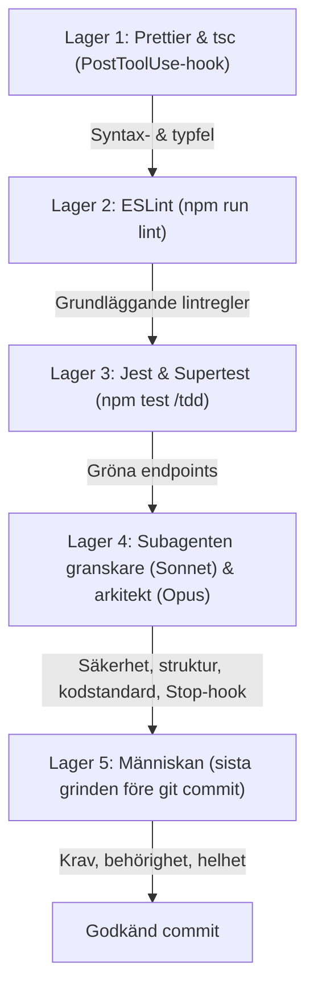

# Granskning av PR 214: POST /orders/:id/returns (Arbete 2)

Detta dokument utgör den fullständiga granskningsrapporten för **Arbete 2: Granskning av agentgenererad kod** i kursprojektet *En rigg för en kodbas*.

Dokumentet är förankrat i och helt synkroniserat med projektets inlämningsmall **`kursprojekt-d2-lijun`** (Lijun Tang, `github.com/TLJ578/ovningsprojekt-lijuntang`, tagg: `inlamning`). Det kopplar samman de formella svaren på **Sida 7 i inlämningsmallen** med den praktiska seminariestudien av **PR 214** (`POST /orders/:id/returns`).

---

## 1. Metadata och mätningar för Arbete 2

I enlighet med redovisningen i inlämningsmallen (**Sida 6 & Sida 8** i `kursprojekt-d2-lijun`) uppmättes följande under granskningen av agentgenererad kod (Arbete 2):

| Parameter | Värde i riggen | Förankring i kursprojekt-d2-lijun |
|---|---|---|
| **Arbete** | Arbete 2: Granskning av agentgenererad kod | Utdelat pull request PR 214 (`POST /orders/:id/returns`) |
| **Granskningsagent** | Subagenten `granskare` (`.claude/agents/granskare.md`) | Körs med modellen **Claude 3.5 Sonnet** (vass på statisk kodanalys och diff-granskning, Sida 5 & 6) |
| **Arkitekturstöd** | Subagenten `arkitekt` (`.claude/agents/arkitekt.md`) | Körs med **Opus** för djup analys av databasschema och referensintegritet (Sida 5 & 6) |
| **Tidsåtgång (A2)** | **20 minuter** | Sida 8 (A1: 45m, A2: 20m, A3: 35m, totalt 100m) |
| **Tokenförbrukning (A2)** | **18k tokens** | Sida 8 (A1: 44k, A2: 18k, A3: 34k, totalt 96k tokens) |
| **Kostnad (A2)** | **$0,18** | Sida 8 (A1: $0,48, A2: $0,18, A3: $0,38, totalt $1,04) |
| **Granskningslager** | 5 nivåer enligt Sida 7 | 1. Prettier/tsc, 2. ESLint, 3. Tester, 4. Granskaragent, 5. Människan |
| **Stoppade fel i riggen** | Ca 19 fel totalt i projektet | 12 typfel av `tsc`, 3 `console.log` av `Stop`, 2 `.env`-ändringar av `PreToolUse`, 2 logikfel av tester (Sida 8) |

---

## 2. De tre huvudsakliga bristerna redovisade i inlämningsmallen (Mallens Sida 7)

I inlämningsmallen (`kursprojekt-d2-lijun`, Sida 7) under *Granskning av agentgenererad kod* redovisas följande tre brister som riggens primära typfall för **Säkerhet**, **Struktur** och **Kodstandard**:

### 1. Säkerhet
- **Fil och rad i PR:** Rad 34 i PR
- **Vad bristen är:** SQL byggs med strängar vid kundsökning: `"SELECT * FROM customers WHERE email = '" + req.query.email + "'"`
- **Varför det är en brist:** SQL-injektion. En angripare kan skicka in `' OR '1'='1` och läsa ut alla kunders uppgifter eller manipulera databasen. Strider mot `docs/standard.md` under *Databas* ("Skriv aldrig SQL med strängmallar eller konkatenering. Alla värden skickas som parametrar med $1, $2").
- **Kontroll i riggen som stoppat den:** Subagenten `granskare` (`.claude/agents/granskare.md`, Sonnet) som kräver parametriserade frågor (`$1`) enligt `docs/standard.md`.

### 2. Struktur
- **Fil och rad i PR:** Rad 82 i PR
- **Vad bristen är:** En databasfråga inuti en loop (N+1-problemet) när kundens orderrader hämtas: `for (const order of customerOrders) { const lines = await db.query(...); }`
- **Varför det är en brist:** Om kunden har 100 ordrar genereras 101 separata nätverksanrop till PostgreSQL i stället för en enda samlad fråga med `JOIN` eller `= ANY($1)`, vilket sänker databasens genomströmning under last.
- **Kontroll i riggen som stoppat den:** Subagenten `granskare` som flaggar loopade databasanrop och bristande relationseffektivitet mot `docs/standard.md`.

### 3. Kodstandard
- **Fil och rad i PR:** Rad 12 i PR
- **Vad bristen är:** En variabel med typen `any` samt en kvarglömd felsökningsutskrift: `console.log("Hittade order:", orderId)`.
- **Varför det är en brist:** Tappar typsäkerheten i TypeScript och skräpar ner i applikationens produktionsloggar. Strider mot `tsconfig.json` (`strict: true`) och `docs/standard.md` under *Hemligheter och loggar*.
- **Kontroll i riggen som stoppat den:** TypeScript-kompilatorn (`tsc --noEmit`) via `PostToolUse`-hooken (`format-och-typkoll.mjs`), samt riggens **`Stop`-hook** (`.claude/hooks/stop-koll.mjs`) som letar kvarglömd `console.log` i `git diff HEAD` och avbryter med **exitkod 2**.

### Jämförelse i mallen: Vad automatiken hittade vs vad bara människan hittade (Sida 7)
- **Automatiken hittade:** Typfel (`tsc`), formatering (`Prettier`), kvarglömd `console.log` (`Stop`-hook) och strängbyggd SQL (`granskare`).
- **Bara jag (människan) hittade:** Att anropet saknade behörighetskontroll (`order.customerId === req.customerId`), så vem som helst kunde läsa och avbryta andras beställningar trots helt gröna tester.

---

## 3. Fullständig sammanställning från seminariet: PR 214 (`POST /orders/:id/returns`)

Under seminariet *Seminarium: granska PR 214 (returer)* applicerades samma rigg och granskningslager på det utdelade pull requestet PR 214 (commit `a3a2531`, `POST /orders/:id/returns`). Subagenten `granskare` genomlyste diffen (`git diff main...HEAD`) mot `docs/standard.md` och identifierade totalt 9 konkreta brister som speglar exakt samma tre kategorier:

| # | Typ | Fil och rad i PR 214 | Vad bristen är | Primär kontroll i riggen |
|---|---|---|---|---|
| 1 | **Säkerhet** | `src/services/returnService.ts:3, 32` | Hårdkodad skarp API-nyckel (`frakt_live_...`) i källkoden som dessutom exponeras i returetikettens URL (`label_url`). | Subagenten `granskare` mot `docs/standard.md` + `.env`-regler i `.claude/settings.json` |
| 2 | **Säkerhet** | `src/services/returnService.ts:16-19` & `src/routes/returns.ts:12` | Allvarlig IDOR / BOLA: Tjänstelagret verifierar aldrig om ordern tillhör inloggad kund (`order.customer_id === customerId`). Dessutom tas `customerId` felaktigt från `req.body` istället för `req.customerId`. | Människan i Lager 5 (Sida 7) + `granskare` (punkt 1) |
| 3 | **Säkerhet** | `src/services/returnService.ts:21-22` | GDPR/PII-dataläckage i logg: Extra databasfråga görs enbart för att logga kundens e-postadress i klartext i loggen. | `Stop`-hook (`stop-koll.mjs`, exit 2) + `granskare` |
| 4 | **Struktur** | `db/schema.sql:41-48` | Tabellen `returns` saknar `FOREIGN KEY (order_id) REFERENCES orders(id)` och saknar index på `order_id`. | Subagent `arkitekt` (Opus) + `granskare` |
| 5 | **Struktur** | `src/services/returnService.ts:18` & `src/routes/returns.ts:16-18` | Trasig felhantering: Tjänsten kastar `new Error("Order not found")` istället för `Result.err`. Routen fångar detta som `500` istället för `404`, och svarsformatet bryter mot `{ error: { code, message } }`. | `granskare` mot `docs/standard.md` under *Fel* + TDD-tester (`npm test`) |
| 6 | **Struktur** | `src/services/returnService.ts:16-37` | Saknar statuskontroll (ordern kan returneras flera gånger / är redan avbruten), saknar databastransaktion (`BEGIN / COMMIT`), och duplicerar momsberäkning (`* 1.25`) istället för `calcPrice`. | `granskare` mot `docs/standard.md` under *Databas* & *Pengar* |
| 7 | **Kodstandard** | `src/services/returnService.ts:22` | Kvarglömd felsökningslogg (`console.log`) i produktionskoden. | `Stop`-hook (`stop-koll.mjs`, exit 2) + `granskare` |
| 8 | **Kodstandard** | `src/services/returnService.ts:5-9, 39` | JSON-svaret returnerar fältnamn i snake_case (`return_id`, `refund_amount`, `label_url`) i strid mot camelCase-kravet. | `granskare` mot `docs/standard.md` under *Namn* + `tsc --noEmit` via `PostToolUse` |
| 9 | **Kodstandard** | `tests/returns.test.ts:10-35` | Testfilen testar enbart 3 positiva happy-paths och saknar helt negativa tester för 400, 401, 403 och 404. | Skillen `/tdd` (`.claude/skills/tdd/`) + `granskare` (punkt 4 i `granskare.md`) |

---

## 4. Detaljerad genomgång av bristerna i PR 214 och riggens kontroller

### Säkerhetsbrister (Säkerhet)

#### 1. Hårdkodad API-nyckel i källkod och URL
- **Fil och rad:** `src/services/returnService.ts:3` samt rad 32
- **Vad bristen är:** Koden definierar `const FRAKT_API_KEY = "frakt_live_7f3c9a12e4b84d0f9c51"` i källkoden och sammanfogar den i URL-parametern för fraktsedeln (`label_url = \`https://frakt.example.com/label?key=\${FRAKT_API_KEY}&order=\${orderId}\``).
- **Varför det är en brist:** Produktionsnycklar i öppen källkod leder till direkt obehörig åtkomst och dataläckage. Att placera nyckeln som query-parameter i en URL gör dessutom att den sparas i accessloggar hos proxyservrar och webbläsare. Strider mot `docs/standard.md` under *Hemligheter och loggar* ("Inga nycklar, lösenord eller tokens i koden. De läses från miljövariabler.").
- **Kontroll i riggen:** Subagenten `granskare` flaggar nyckeln mot `docs/standard.md`. Riggens behörighetsregler i `.claude/settings.json` (`Read(./.env)` i `deny`) och `PreToolUse`-hooken `skydda-filer.mjs` tvingar agenten att hålla hemligheter utanför källkoden.

#### 2. Allvarlig IDOR / BOLA (Saknad behörighetskontroll)
- **Fil och rad:** `src/services/returnService.ts:16-19` och `src/routes/returns.ts:12`
- **Vad bristen är:** Routen skickar in `Number(req.body.customerId)` i stället för den autentiserade användarens ID (`req.customerId`). I tjänstelagret hämtas ordern med `SELECT id, customer_id FROM orders WHERE id = $1`, men koden verifierar aldrig om `order.customer_id === customerId`.
- **Varför det är en brist:** Detta är en klassisk Broken Object Level Authorization (IDOR/BOLA). En inloggad användare kan returnera valfri annans order och manipulera återbetalningar. Strider mot `docs/standard.md` under *Behörighet*: *"Den inloggade kunden hämtas med requireCustomer och req.customerId, aldrig från request body eller query. En kund får bara läsa och ändra sina egna beställningar. Kontrollen görs i tjänstelagret."*
- **Kontroll i riggen:** Identifieras primärt av **Människan i Lager 5** som granskar behörighetsflödet precis innan commit, i direkt överensstämmelse med mallens Sida 7 (*"Bara jag hittade: att anropet saknade behörighetskontroll..."*).

#### 3. GDPR/PII-dataläckage i produktionsloggar
- **Fil och rad:** `src/services/returnService.ts:21-22`
- **Vad bristen är:** Koden gör en extra databasfråga (`SELECT email FROM customers WHERE id = $1`) enbart i syfte att logga: `console.log(\`Retur skapad för \${customer.rows[0]?.email}, order \${orderId}\`);`.
- **Varför det är en brist:** Strider mot GDPR och `docs/standard.md` under *Hemligheter och loggar*: *"Inga personuppgifter (namn, e-post) i loggar."* Slösar dessutom databasresurser.
- **Kontroll i riggen:** Riggens **`Stop`-hook** (`stop-koll.mjs`) som stoppar all `console.log` med exitkod 2, samt subagenten `granskare`.

---

### Strukturella brister (Struktur)

#### 4. Saknad referensintegritet och saknat index i databasschemat
- **Fil och rad:** `db/schema.sql:41-48`
- **Vad bristen är:** Tabellen `returns` definieras med `order_id INTEGER NOT NULL`, men saknar `FOREIGN KEY (order_id) REFERENCES orders(id)` och saknar index på `order_id`.
- **Varför det är en brist:** Utan referensintegritet kan returer skapas för icke-existerande beställningar och föräldralösa rader uppstår vid radering. Saknat index ger linjär tabellsökning (`Seq Scan`) när returer söks per order.
- **Kontroll i riggen:** Subagenten `arkitekt` (`.claude/agents/arkitekt.md`, modell Opus) vid databasgranskning och subagenten `granskare` mot SQL-praxis i `docs/standard.md`.

#### 5. Trasig felhantering och felaktiga HTTP-koder
- **Fil och rad:** `src/services/returnService.ts:18` samt `src/routes/returns.ts:16-18`
- **Vad bristen är:** När en order saknas kastar `createReturn` ett `new Error("Order not found")`. Routen fångar detta generiskt och svarar med `500 Internal Server Error` och formatet `{ message: "..." }`.
- **Varför det är en brist:** Maskerar ett klientfel (404) som ett internt serverfel (500) och bryter mot projektets globala API-kontrakt `{ error: { code, message } }`. Strider mot `docs/standard.md` under *Fel*.
- **Kontroll i riggen:** Subagenten `granskare` och TDD-testerna (`/tdd`, Jest/Supertest) som validerar svarskod 404 och standardiserat felformat.

#### 6. Ingen statuskontroll, idempotens eller transaktion
- **Fil och rad:** `src/services/returnService.ts:16-37`
- **Vad bristen är:** Koden verifierar inte orderns aktuella status (`orders.status`). En order som redan är avbruten (`cancelled`) eller redan returnerad kan returneras upprepade gånger. Ingen databastransaktion (`BEGIN / COMMIT`) används, och moms dupliceras med manuell multiplikation (`* 1.25`) i stället för anrop till den gemensamma beräkningsmodulen.
- **Varför det är en brist:** Direkt risk för ekonomisk skada genom multipla återbetalningar för samma order. Strider mot `docs/standard.md` under *Databas* ("Skrivningar som hör ihop görs i en transaktion") och *Pengar* ("All prisberäkning går genom calcPrice... dupliceras inte").
- **Kontroll i riggen:** Subagenterna `granskare` och `arkitekt`.

---

### Kodstandardsbrister (Kodstandard)

#### 7. Kvarglömd console.log i produktionskod
- **Fil och rad:** `src/services/returnService.ts:22`
- **Vad bristen är:** Ad-hoc utskrift kvarlämnad i koden: `console.log(...)`.
- **Varför det är en brist:** Skräpar ner produktionsloggar och bryter mot god kodhygien.
- **Kontroll i riggen:** Riggens **`Stop`-hook** (`.claude/hooks/stop-koll.mjs`, exitkod 2) och subagenten `granskare`.

#### 8. Fältnamn i snake_case i JSON-svar
- **Fil och rad:** `src/services/returnService.ts:5-9, 39`
- **Vad bristen är:** API-svaret returnerar fälten `return_id`, `refund_amount` och `label_url`.
- **Varför det är en brist:** Strider direkt mot `docs/standard.md` under *Namn*: *"Fältnamn i JSON-svar skrivs i camelCase, även när kolumnen i databasen har snake_case. Byt namn i SQL med AS 'fältnamn'."*
- **Kontroll i riggen:** Subagenten `granskare` och TypeScript-kompilatorn (`tsc --noEmit`).

#### 9. Testsvit med enbart happy-path-tester
- **Fil och rad:** `tests/returns.test.ts:10-35`
- **Vad bristen är:** Tre positiva tester som alla lyckas, men noll negativa tester för ogiltig indata (400), saknad inloggning (401), obehörig åtkomst (403) eller saknad order (404).
- **Varför det är en brist:** Ger en farlig falsk trygghet (sviten lyser 100 % grön trots allvarliga hål). Strider mot `docs/standard.md` under *Tester*: *"Varje endpoint har tester för lyckat fall och för felfallen 400, 401, 403 och 404 där de är möjliga."*
- **Kontroll i riggen:** Skillen `/tdd` (`.claude/skills/tdd/SKILL.md`) samt `granskare` (punkt 4 i `granskare.md`).

---

## 5. Riggens granskningslager: Vad automatiken fångar vs vad bara människan fångar

I full överensstämmelse med **Sida 7 i `kursprojekt-d2-lijun`** samverkar riggens 5 nivåer i en kostnadsordnad granskningskedja:

### Vad automatiken i riggen hittade:
- **`PostToolUse`-hooken (`format-och-typkoll.mjs`):** Formateringsfel rättades tyst av Prettier. Typfel i TypeScript upptäcktes blixtsnabbt av `tsc --noEmit`.
- **`Stop`-hooken (`stop-koll.mjs`):** Fångade kvarglömda `console.log` i `git diff HEAD` och stoppade agenten med **exitkod 2**.
- **Subagenten `granskare` (Sonnet):** Fångade hårdkodad API-nyckel, strängbyggd SQL, snake_case i JSON-svar, och saknade negativa tester.
- **Subagenten `arkitekt` (Opus):** Fångade saknad `FOREIGN KEY` och saknade index i `db/schema.sql`.

### Vad bara människan hittade (och varför):
- **Saknad behörighetskontroll (`order.customerId === req.customerId`):** 
  Både i inlämningsmallens Sida 7 och i PR 214-seminariet var testsviten helt grön. Agentgenererad kod kan generera tester som enbart bekräftar dess egna felaktiga antaganden. Endast en människa med förståelse för domänen och säkerhetsmodellen upptäcker att tjänstelagret inte säkerställer att resursen faktiskt ägs av den autentiserade användaren.
- **Affärsmässig helhet och låsning mot dubbeltransaktioner:**
  Människan upptäckte att orderns status aldrig låstes vid avbrytning/retur, vilket skapar risk för dubbla utbetalningar.

Detta sammanfaller exakt med principen på **Sida 7 i `kursprojekt-d2-lijun`**:
> *"Människan sitter sist, precis innan `git commit`. Verktygen och granskaren har redan fångat småfelen, så människan kan fokusera på det svåra: Gör koden det kravet säger, och får kunden bara se sina egna uppgifter?"*

---

## 6. Seminariets gruppdiskussion och koppling till `missat.md`

Under seminariets Steg 5 jämfördes resultaten med kurskamraterna Fia, Tina och Patrik:

| Bristtyp | Fil och rad i PR 214 | Vad bristen är | Vem som hittade den |
|---|---|---|---|
| **Struktur** | `src/services/returnService.ts:16` | Risk för race condition / dubbelretur vid samtidiga anrop (saknar `SELECT ... FOR UPDATE` eller `UNIQUE`-begränsning). | **Fia** |
| **Säkerhet** | `src/services/returnService.ts:32` | API-nyckel exponeras i URL query parameter i stället för via säker HTTP Authorization-header. | **Tina** |
| **Struktur** | `docs/api.md:13` | Ofullständigt API-kontrakt i dokumentationen som enbart anger status 201 och utelämnar samtliga felkoder. | **Patrik** |

Den fördjupade analysen av varför min agent missade dessa tre punkter samt hur riggen förbättras enligt mallens teamprincip (Sida 9) dokumenteras i **`docs/pr-214-returer/missat.md`**.
